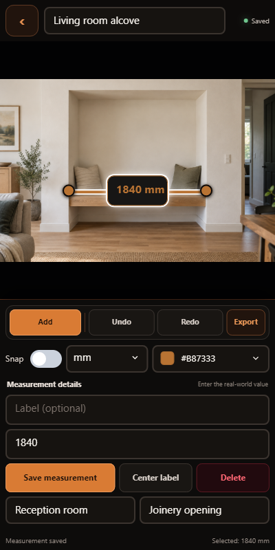

# AnnoTape

<p align="center"></p>

AnnoTape is an offline Android measurement notebook that works with photos, manual values, and a supported physical laser measuring device. Capture or choose a photo, draw optionally angle-snapped dimension lines over it, choose annotation colours and image-wide units, position attached or free labels, and share or save an annotated image. Label scaling defaults to Auto so labels remain readable while the photo is zoomed; fixed 100%, 75%, 50%, and 25% display sizes are also available from the editor toolbar. A Windows desktop host supports development and layout testing.

The entered value is authoritative. AnnoTape does not infer physical dimensions from ordinary photo pixels and never labels pixel-derived values as measurements.



## Physical measuring-device support

AnnoTape has direct, hardware-tested support for the **HOTO Smart Laser Measure QWCJY001**, which may advertise over Bluetooth as `xiaojiang.cc_9e2`.

### Offline and account-free

**No account is needed.** AnnoTape has no sign-in, registration, or cloud account system. It does not connect to Xiaomi, HOTO, Mi Home, or other vendor servers. The Android app does not declare the `INTERNET` permission, so it cannot use ordinary Android networking to send meter data to those services.

Pairing and authentication take place directly between the phone and meter over local Bluetooth Low Energy. The resulting meter token stays in AnnoTape's private storage on the phone, with Android cloud backup disabled. Photos, annotations, measurements, and project details also remain local unless the user deliberately exports an image.

- Connect the meter from AnnoTape's main page and take real measurements with the physical device.
- A reading automatically updates and saves the currently selected photo annotation, including normal undo history and crash-safe project autosave.
- If no annotation is selected, the reading remains in the measurement field until one is selected or drawn.
- Pairing, authentication, and measurement transfer happen directly over local Bluetooth Low Energy.
- Mi Home and the Xiaomi/HOTO cloud are not involved.

Support is currently specific to the QWCJY001 protocol; other Bluetooth measuring devices are not yet claimed as compatible.

## Current state

The architecture spike and testable MVP are implemented. The portable editor, SQLite persistence, recovery state, camera/photo-picker boundary, and full-resolution PNG/JPEG export compile. Automated tests pass. Camera interoperability, process-death return, gestures, memory limits, and TalkBack still require representative Android hardware before a release claim.

The 0.3 release uses one photo per project. The schema already supports ordered multi-photo projects, so adding a document navigator does not require a migration.

## Stack

- C# and .NET 10
- Plain .NET for Android (no MAUI, WebView, JavaScript, or browser shell)
- [CupriFace](https://github.com/Wixely/CupriFace) engine, shell, and Android host `0.41.0` from pinned source
- SQLite with Dapper and DnaX `10.0.0-alpha.2` checksummed migrations
- SkiaSharp source-resolution export
- Minimum Android API 24; Android 13+ uses the system photo picker and earlier releases use `ACTION_OPEN_DOCUMENT`

CupriFace currently requires Android CoreCLR (`UseMonoRuntime=false`). The .NET Android SDK describes CoreCLR as experimental, so this is an explicit pre-release constraint rather than a production-support claim.

ReadyToRun is disabled for the APK because the Windows Android toolchain attempted to rewrite a mapped generated resource assembly (`NETSDK1096`). Release builds use conservative partial trimming: framework and SDK assemblies that explicitly support trimming are reduced, while AnnoTape and CupriFace's reflection-based bindings are not fully trimmed. The resulting CoreCLR/JIT package builds reliably; startup and package-size measurements remain part of device acceptance.

## Build and test

Prerequisites are .NET SDK `10.0.300`, the .NET Android workload, and a clean DnaX checkout beside this repository at its pinned commit:

```text
git/
  AnnoTape/
  DnaX/        # commit ab1471dd0caa3775f3bd26f9f12bf04d7df8752e
  CupriFace/   # commit a331aace00f27d1e84565250ba4bd20aa926852a
```

Then run:

```powershell
.\eng\Prepare-DnaXPackages.ps1
.\eng\Prepare-CupriFacePackages.ps1
dotnet test tests\AnnoTape.Core.Tests\AnnoTape.Core.Tests.csproj -c Debug
dotnet test tests\AnnoTape.App.Tests\AnnoTape.App.Tests.csproj -c Debug
dotnet build src\AnnoTape.Desktop\AnnoTape.Desktop.csproj -c Debug
dotnet build src\AnnoTape.Android\AnnoTape.Android.csproj -c Debug
```

The preparation scripts populate the ignored repository-local `.packages` feed. DnaX and all three
CupriFace packages are built from pinned checkouts. Pass `-DnaXRoot` or `-CupriFaceRoot` when either
checkout is elsewhere.

GitHub Actions runs the Release tests, builds the Windows desktop layout host, and publishes a
downloadable ARM64 test-signed APK plus its SHA-256 checksum on every push and pull request. The
workflow can also be started manually. The artifact is suitable for testing, not store release.

For desktop layout testing, select **Run AnnoTape Desktop (layout testing)** in VS Code's Run and Debug view and press F5. The desktop Camera and Photo picker actions both open a local image picker. Exports can open in the registered Windows image application or be saved through the native file dialog.

Build an installable release APK with:

```powershell
dotnet publish src\AnnoTape.Android\AnnoTape.Android.csproj -c Release -r android-arm64
```

The APK is written below `src\AnnoTape.Android\bin\Release\net10.0-android\android-arm64\publish\`. Debug deployment and attach tasks are included in `.vscode`.

## Privacy and storage

Projects, untouched source media, annotations, notes, user-entered locations, and the HOTO meter's local pairing token stay in app-private storage. The application requests Nearby devices access on Android 12 and later. Android 7–11 expose BLE scanning through the legacy fine-location permission even though AnnoTape never reads device location. No network, microphone, or broad-storage permission is declared. Export is the only intentional disclosure path. See [docs/PRIVACY.md](docs/PRIVACY.md) and [docs/TESTING.md](docs/TESTING.md).

## Repository map

- `src/AnnoTape.Core`: geometry, units, commands, migrations, storage, and export
- `src/AnnoTape.App`: portable CupriFace UI and editor workflow
- `src/AnnoTape.Desktop`: Windows CupriFace host for interactive layout testing
- `src/AnnoTape.Android`: camera, picker, Android lifecycle, content URI, and sharing boundary
- `tests`: core and portable render tests
- `docs`: architecture, testing, signing, and privacy guidance

## License

AnnoTape is licensed under the [MIT License](LICENSE). Dependency notices are in [THIRD-PARTY-NOTICES.md](THIRD-PARTY-NOTICES.md).
